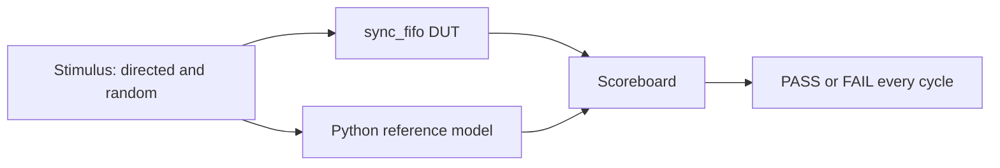
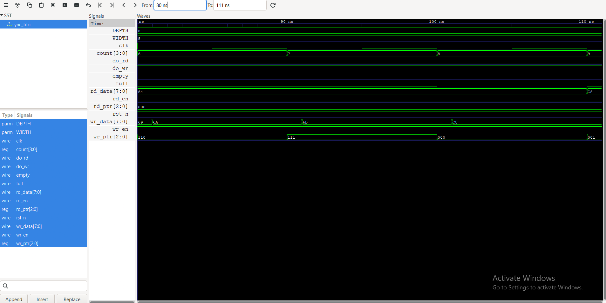
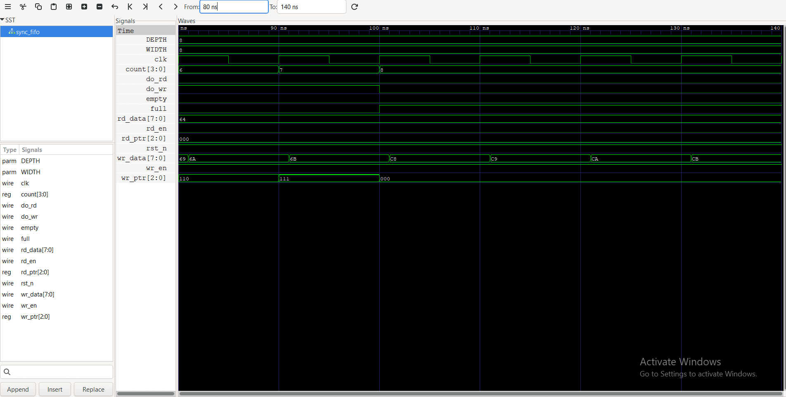

# Synchronous FIFO: Verified with cocotb

[](https://github.com/madhu-dev-ai/sync-fifo-verification/actions/workflows/test.yml)

A parameterised synchronous FIFO in SystemVerilog, checked with a cocotb testbench that has a Python reference model, a cycle-by-cycle scoreboard, corner-case tests and a fixed-seed constrained-random test.

## Design

- Parameters: `WIDTH` (data width) and `DEPTH` (power of 2)
- Outputs: `full`, `empty`, `count`, `rd_data`
- A write when full is ignored. A read when empty is ignored.
- Read and write in the same cycle are both accepted (when possible), and `count` stays the same.

## Testbench architecture



After every clock cycle the scoreboard compares `count`, `full`, `empty` and `rd_data` of the DUT with the Python model.

## Tests

| Test | What it checks |
|------|----------------|
| test_fill_and_drain | Fill to full, then drain to empty |
| test_write_when_full | Extra writes into a full FIFO are dropped |
| test_read_when_empty | Reads from an empty FIFO are ignored |
| test_simultaneous_read_write | Read and write together when empty, half full and full |
| test_wraparound | 4 x DEPTH words pass through, pointers wrap many times |
| test_constrained_random | 3000 random cycles, changing read/write bias, seed 1234 |

The random test also counts which situations it reached (full, empty, read and write together, write when full, read when empty) and fails if any of them was never hit.

## Bug story: write accepted when full

I planted a bug on purpose: I removed the full check from the write enable.

```
Good:   assign do_wr = wr_en && !full;
Buggy:  assign do_wr = wr_en;
```

**Before (buggy):** 3 of the 6 tests failed. In the waveform, `full` goes high at 100 ns, but `do_wr` stays 1. The extra write is accepted, `count` reaches 9 in an 8-deep FIFO, and `rd_data` changes from 64 to C8 with no read. The new word overwrote the oldest word, so data was lost.



**After (fixed):** with the full check back, `do_wr` drops to 0 when `full` goes high, `count` stays at 8 and `rd_data` stays at 64.



## What I learned

- A reference model plus a scoreboard that checks every cycle finds bugs faster than checking only at the end.
- Corner cases (full, empty, wrap-around, read and write together) are where FIFO bugs hide.
- A fixed random seed makes a random failure repeatable.
- Reading a waveform means finding the first cycle where the DUT and the model disagree.
- Counting which situations the random test reached shows whether it is really testing the corners.

## Run it

```
make
make WAVES=1
gtkwave sim_build/sync_fifo.fst
```

Needs Icarus Verilog 12, Python 3.10 and cocotb 2.1.0.

## Possible next steps

- Add an assertion-style check for `count` never going above `DEPTH`
- Add functional coverage bins for fill levels
- Port the testbench to UVM on EDA Playground
